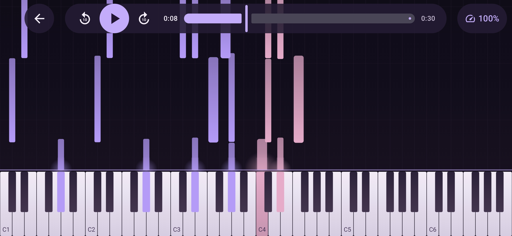
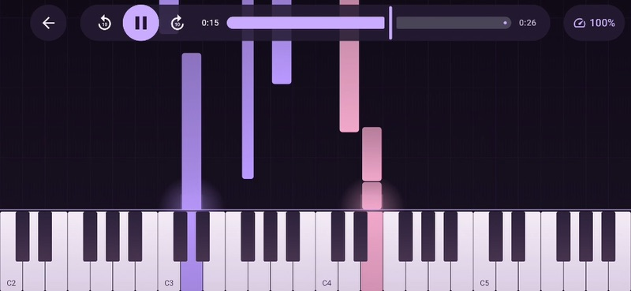

# Piano Rain

An offline Android app that plays piano recordings with falling notes and a live keyboard.
Import piano audio, wait for the local transcription (**Ready**), then open it in the player.



Bundled demos:

- Bach’s gentle *Goldberg Variations — Aria* (26.5 seconds, Kimiko Ishizaka, CC0)
- Chopin’s chord-heavy *Prelude in C minor, Op. 28 No. 20* (30 seconds, Ivan Ilic, CC BY 3.0)

## Features

- Local audio import with progress, cancellation, retry and removal.
- Landscape piano roll drawn live from note events.
- Play/pause, seeking, ten-second skips and 25%–100% playback speed with preserved pitch.
- No account, server or audio upload.

Imports support mono/stereo audio at 8–96 kHz, up to 10 minutes / 100 MB. M4A/AAC, MP3 and PCM WAV support depends on Android's decoders. Keep at least 500 MB free. Cancelling waits for the current inference window to finish. Removing a song deletes the app's copy; the original file stays intact.

## Transcription accuracy

PianoRain uses Kong/ByteDance's **Note_pedal** model, exported from `piano_transcription_inference` 0.0.6 to ONNX opset 17 with the original float32 weights.
Inference runs offline on the CPU through ONNX Runtime Android 1.23.2. See the [model details and attribution](android/app/src/main/assets/models/README.md).

The model is intended for solo piano, and we have not tested it with other instruments or ensemble recordings. Its transcriptions are approximate. It can be a useful tool for pianists, but beginners should be aware of noise and 'ghost notes'.
See [Development](#development) for possible improvements to transcription accuracy.

[](docs/media/piano-rain-demo-sound.mp4)

[Watch the demo with sound (30 seconds)](docs/media/piano-rain-demo-sound.mp4): Bach’s Aria and Chopin’s Prelude, with approximate transcriptions. Recordings by Kimiko Ishizaka (CC0) and Ivan Ilic (CC BY 3.0); see [demo credits and edits](android/app/src/main/assets/licenses/DEMO.txt).

## Built with

Kotlin, Jetpack Compose, Media3 ExoPlayer, Android MediaCodec and ONNX Runtime.
A single app module handles the library, transcription and playback.

## Build

Requires JDK 17 and Android SDK 36. The app supports Android 8.0+ (API 26) and currently packages arm64 native libraries.

1. Provision the ignored ONNX model using the [model instructions](android/app/src/main/assets/models/README.md). A fresh checkout does not include it.
2. Open `android/` in Android Studio, or set `sdk.dir` in `android/local.properties`.

```sh
cd android
if [ ! -f app/debug.keystore ]; then
  keytool -genkeypair -keystore app/debug.keystore -storepass android -keypass android -alias androiddebugkey -dname 'CN=Android Debug,O=Android,C=US' -keyalg RSA -validity 10000
fi
./gradlew testDebugUnitTest assembleDebug lintDebug --console=plain
```

Keep the same debug key for APK updates. Do not commit it or `local.properties`.
The APK is `android/app/build/outputs/apk/debug/app-debug.apk`; application ID is `com.pianorain`.

## Development

See [CONTRIBUTING.md](CONTRIBUTING.md) for developer guidance, code structure, timing rules, limitations and device checks.
Unit tests protect MIDI timing, note extraction, geometry and import completion. They do not verify physical audio sync or rendering performance.

Filtering out false note detections and improving audio processing are possible starting points for contributions aimed at better transcription accuracy.

## License

Original code and documentation use [Apache 2.0](LICENSE). The model uses CC BY 4.0; libraries retain their own licenses. See [third-party notices](THIRD_PARTY_NOTICES.md), also available offline through **Songs → Licenses**.

The Aria demo uses CC0; the Chopin recording/excerpt uses CC BY 3.0. Generated MIDI and regression data use CC0 without replacing the recording’s license; see the [demo attribution](android/app/src/main/assets/licenses/DEMO.txt). The former personal sample is kept only in ignored local storage. Private assets are excluded from repository history.
